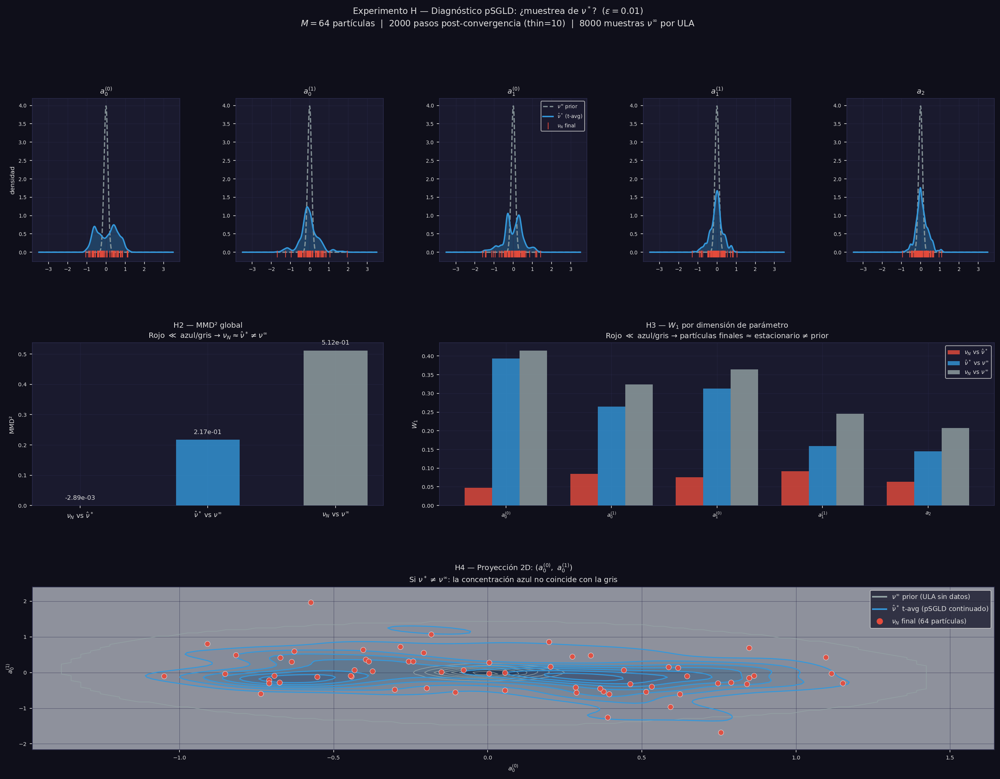
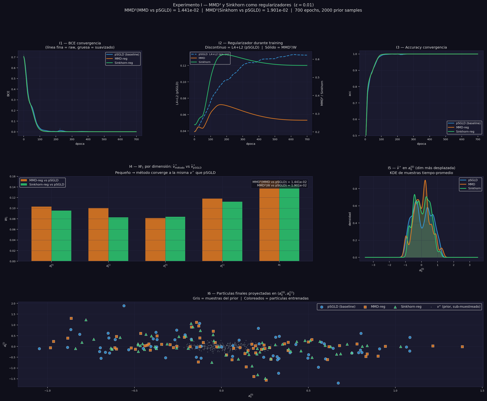

# Langevin, MMD and Sinkhorn training of entropic mean-field Neural ODEs

[](https://www.python.org/)
[](LICENSE)
[](https://arxiv.org/abs/2507.08486)

Code by **Daniel Torres González** (ICMAT–CSIC, JAE Intro fellowship, 2026).

Daudin and Delarue (2025) study a continuum-depth ResNet as a mean-field control
problem with entropic regularization: the parameters are a distribution ν, and the
optimal ν\* has a Gibbs form. This repository trains the particle version of that
model (M neurons) on `make_moons`, `make_circles` and California Housing, and
compares three ways of imposing the entropic regularization:

| Method | What it does | Where |
| --- | --- | --- |
| **pSGLD** (preconditioned stochastic gradient Langevin dynamics) | Each step is an Euler–Maruyama step of the Langevin SDE dθ = −∇J(θ) dt + √(2ε) dW, preconditioned with Adam's second moment: θ ← θ − η M ∇J + √(2ηεM) ξ | [`mfnode/train.py`](mfnode/train.py) |
| **MMD regularizer** | Adam without noise, with penalty ε·MMD²(particles, prior) (Gaussian kernel, median bandwidth) | [`mfnode/metrics.py`](mfnode/metrics.py) |
| **Sinkhorn regularizer** | Adam without noise, with the debiased Sinkhorn divergence (log-domain entropic OT) between particles and prior | [`mfnode/metrics.py`](mfnode/metrics.py) |

Samples of the prior ν^∞ ∝ exp(−ℓ(a)), with ℓ(a) = 0.05|a|⁴ + 0.5|a|², are drawn with
the unadjusted Langevin algorithm (ULA), also an Euler–Maruyama discretization.
Distributions are compared with MMD², per-coordinate Wasserstein-1 and Sinkhorn
divergences.

> S. Daudin, F. Delarue, *Genericity of Polyak–Łojasiewicz inequalities for entropic
> mean-field Neural ODEs*, [arXiv:2507.08486](https://arxiv.org/abs/2507.08486) (2025).

## Model

dX_t/dt = (1/M) Σₘ tanh(a₁ᵐ · X_t + a₂ᵐ) a₀ᵐ on [0, 1], integrated with RK4 (10 steps),
directly in the input space ℝ² (no embedding). The loss is the terminal cost
(BCE for classification, MSE for regression) plus ε times the regularizer.

## Experiments

| | Question | Figure |
| --- | --- | --- |
| A | Does the flow transport the two moons to a linearly separable configuration? | `A_feature_evolution.png` |
| B | Effect of ε on convergence, decision boundaries and the Gibbs shape of ν\* | `B1`, `B2` |
| C | Does the PL inequality ‖∇J‖² ≥ 2μ(J − J\*) hold along training? | `C_pl_verification.png` |
| D, E | Genericity: is the minimizer stable across initialization and data seeds? | `D_genericity.png`, `E_parameter_robustness.png` |
| F | On `make_circles`, does ν\* inherit the SO(2) symmetry of the data? | `F_circles_parameter_distribution.png` |
| G | Empirical convergence J\*_N → J\*_∞ as the training set grows | `G_convergence_problem.png` |
| **H** | Does pSGLD actually sample from ν\*? (MMD² and W₁ between final particles, time-averaged ν̂\* and the prior) | `H_psgld_diagnostic.png` |
| **I** | Can the Langevin noise be replaced by an explicit MMD or Sinkhorn penalty? | `I_regularizer_comparison.png` |
| **J** | The same comparison on real data: California Housing regression (PCA to ℝ², train/test R²) | `J_california_regression.png` |
| **K** | ε sweep for the regression task, per method | `K_epsilon_sweep.png` |





## Run

```bash
pip install -r requirements.txt
python -m mfnode --experiment H              # one experiment
python -m mfnode --experiment I --epochs 300 # override the number of epochs
python -m mfnode                             # all experiments (slow)
```

Figures are written to `figures/`. Experiment J downloads California Housing
through scikit-learn on first use.

## Layout

```
mfnode/
  model.py        mean-field velocity field and RK4 Neural ODE
  train.py        Adam / pSGLD training loop, PL constant estimate
  metrics.py      MMD², Sinkhorn divergence, W₁, ULA prior sampler, pSGLD snapshots
  data.py         make_moons, make_circles
  experiments/    exp_a.py … exp_k.py
  main.py         command-line entry point
docs/             full write-up of the experiments and the mathematical setup (in Spanish)
figures/          figures produced by the experiments
```

Code comments and the documents in `docs/` are in Spanish.

## Related repositories

- [mfnode-pl-verification](https://github.com/dantor03/mfnode-pl-verification): the follow-up preprint, which computes ν\* with an explicit Gibbs solver and verifies the PL inequality quantitatively.
- [daudin-delarue-moons](https://github.com/dantor03/daudin-delarue-moons): the first exploratory version (experiments A–F), archived.

## License

[MIT](LICENSE)
