# Documentación técnica — Neural ODEs de Campo Medio con Regularización Entrópica

**Referencia:** Daudin, S. & Delarue, F. (2025). *Genericity of the Polyak-Łojasiewicz inequality for mean-field Neural ODEs with entropic regularization.* arXiv:2507.08486.

**Código:** `python -m mfnode` — ejecuta todos los experimentos. Opciones: `--experiment {A,B,C,D,E,F,G,H,I,J,K}`, `--epochs N`, `--plot-only`. Cada experimento guarda los datos de su figura en `figures/data/<X>.npz` y la dibuja con `mfnode/plotting/`; `--plot-only` rehace las figuras desde esos archivos sin entrenar.

---

## Índice

- [1. Contexto y motivación](#1-contexto-y-motivación)
- [2. Marco teórico](#2-marco-teórico)
- [3. Implementación](#3-implementación)
- [4. Experimento A — Evolución de $\gamma_t$](#4-experimento-a--evolución-de-gamma_t-marginal-en-x)
- [5. Experimento B — Efecto del parámetro $\varepsilon$](#5-experimento-b--efecto-del-parámetro-varepsilon)
- [6. Experimento C — Verificación empírica de la condición PL](#6-experimento-c--verificación-empírica-de-la-condición-pl)
- [7. Experimento D — Genericidad: robustez a semillas](#7-experimento-d--genericidad-robustez-a-semillas)
- [8. Experimento E — Robustez de $\nu^*$ (make\_moons)](#8-experimento-e--robustez-de-nu-make_moons)
- [9. Experimento F — Convergencia en make\_circles](#9-experimento-f--convergencia-en-make_circles)
- [10. Experimento G — Problema de convergencia ($N \to \infty$)](#10-experimento-g--problema-de-convergencia-n-to-infty)
- [11. Experimento H — Diagnóstico de pSGLD](#11-experimento-h--diagnóstico-de-psgld)
- [12. Experimento I — MMD y Sinkhorn como regularizadores (make\_moons)](#12-experimento-i--mmd-y-sinkhorn-como-regularizadores-make_moons)
- [13. Experimento J — Regresión: California Housing PCA(2)](#13-experimento-j--regresión-california-housing-pca2)
- [14. Experimento K — Barrido de $\varepsilon$ en regresión](#14-experimento-k--barrido-de-varepsilon-en-regresión)
- [15. Conclusiones](#15-conclusiones)
- [Referencias](#referencias)

---

## 1. Contexto y motivación

Las redes neuronales profundas se pueden entender como sistemas de control: cada capa transforma la representación de los datos, y el objetivo es aprender los parámetros de esa transformación para que la representación final sea fácilmente clasificable. En el límite de capas continuas, esta idea da lugar a las **Neural ODEs** (Chen et al., 2018). En el límite de neuronas infinitas por capa, aparece el **límite de campo medio**.

El paper de Daudin & Delarue (2025) estudia la intersección de ambos límites y demuestra dos resultados sorprendentes:

- La existencia de un **minimizador estable único** es genérica (ocurre para casi toda distribución inicial de datos).
- Cerca de ese minimizador, se satisface la **desigualdad de Polyak-Łojasiewicz (PL)**, lo que garantiza **convergencia exponencial** del descenso en gradiente hacia el óptimo global — sin ninguna hipótesis de convexidad.

Este documento presenta la verificación empírica de estos resultados sobre los datasets `make_moons` y `make_circles` de scikit-learn.

---

## 2. Marco teórico

### 2.1 Neural ODEs en el límite de campo medio

Una red ResNet profunda con $L$ capas converge, cuando $L \to \infty$, a la **ODE**:

$$\frac{dX_t}{dt} = F(X_t, t), \quad t \in [0, T], \quad X_0 = \text{dato de entrada}$$

Si además cada capa tiene $M \to \infty$ neuronas, la distribución de parámetros converge a una **medida** $\nu_t \in \mathcal{P}(A)$ y el campo vectorial efectivo es:

$$F(x, t) = \int_A b(x, a) \, d\nu_t(a)$$

El problema de optimización consiste en encontrar la trayectoria de medidas $(\nu_t)_{t \in [0,T]}$ que minimiza el coste total.

### 2.2 Campo vectorial prototípico

El paper usa el campo prototípico (Ejemplo 1.1, ec. 1.8):

$$b(x, a) = \sigma(a_1 \cdot x + a_2) \cdot a_0, \quad \sigma = \tanh$$

donde $a = (a_0, a_1, a_2) \in A = \mathbb{R}^{d_1} \times \mathbb{R}^{d_1} \times \mathbb{R}$.

El campo efectivo con $M$ partículas es:

$$F(x, t) \approx \frac{1}{M} \sum_{m=1}^{M} \sigma\left(a_1^m \cdot x + a_2^m\right) \cdot a_0^m$$

que es una **red neuronal de una capa oculta** con $M$ neuronas y parámetros que varían en el tiempo $t$.

### 2.3 Ecuación de continuidad

La distribución de datos $\gamma_t$ en el instante $t$ evoluciona según la ecuación de continuidad (ec. 1.3):

$$\partial_t \gamma_t + \text{div}_x\left(F(x, t) \, \gamma_t\right) = 0$$

La solución formal es $\gamma_t = (\phi_t)_{\sharp} \gamma_0$: el flujo $\phi_t$ desplaza solo la componente de features $X_0^i \to X_t^i$; la etiqueta $Y_0^i$ permanece invariante bajo el flujo.

### 2.4 Regularización entrópica y control óptimo

La función objetivo del problema de control es (ec. 1.6):

$$J(\gamma_0, \nu) = \underbrace{\int L(x, y) \, d\gamma_T(x, y)}_{\text{coste terminal (BCE)}} + \underbrace{\varepsilon \int_0^T \mathcal{E}(\nu_t \mid \nu^\infty) \, dt}_{\text{penalización entrópica (KL)}}$$

El prior es $\nu^\infty(da) \propto e^{-\ell(a)} \, da$ con potencial **supercoercivo**:

$$\ell(a) = c_1 |a|^4 + c_2 |a|^2, \quad c_1 = 0.05, \quad c_2 = 0.5$$

La supercoercividad ($c_1 > 0$) garantiza la **desigualdad de log-Sobolev** para $\nu^\infty$, que es el ingrediente técnico que conecta la regularización entrópica con la condición PL.

El control óptimo $\nu_t^*$ tiene la **forma de Gibbs** (ec. 1.9):

$$\nu_t^*(da) \propto \exp\left(-\ell(a) - \frac{1}{\varepsilon} \int b(x, a) \cdot \nabla u_t(x,y) \, d\gamma_t\right) da$$

donde $u_t$ es la función de valor (solución de Hamilton-Jacobi-Bellman hacia atrás).

### 2.5 La condición Polyak-Łojasiewicz

La **condición PL** establece que existe $\mu > 0$ tal que:

$$\|\nabla J(\theta)\|^2 \geq 2\mu \cdot (J(\theta) - J^*)$$

Si la condición PL se cumple con tasa de aprendizaje $\eta$, la convergencia es **exponencial**:

$$J(\theta_k) - J^* \leq (1 - 2\eta\mu)^k \cdot (J(\theta_0) - J^*)$$

La condición PL es **más débil que la convexidad estricta** pero suficiente para garantizar convergencia global al mínimo.

### 2.6 Los dos Meta-Teoremas

**Meta-Teorema 1** (genericidad): Existe un conjunto abierto y denso $\mathcal{O}$ de condiciones iniciales $\gamma_0$ tal que para todo $\gamma_0 \in \mathcal{O}$, el problema de control tiene un único minimizador **estable**.

**Meta-Teorema 2** (condición PL local): Para $\gamma_0 \in \mathcal{O}$ y $\varepsilon > 0$, la condición PL se cumple localmente cerca del minimizador estable. La constante $\mu > 0$ existe para cualquier $\varepsilon > 0$, por pequeño que sea, pero la PL solo está garantizada en un entorno del óptimo, no en todo el espacio de parámetros.

---

## 3. Implementación

### 3.1 Dataset

Se usa `make_moons` de scikit-learn con $N = 400$ puntos y ruido $\sigma = 0.12$, estandarizado con `StandardScaler`. El experimento F usa `make_circles` ($N=400$, noise=0.08, factor=0.5). El experimento G varía $N \in \{25, 50, 100, 200, 400, 800\}$. Los experimentos J y K usan **California Housing** proyectado a $\mathbb{R}^2$ mediante PCA (varianza explicada: 48.9%), con $N_\text{train}=800$ y $N_\text{test}=400$.

En el lenguaje del paper, los datos constituyen la **distribución inicial empírica**:

$$\gamma_0 = \frac{1}{N} \sum_{i=1}^{N} \delta_{(X_0^i,\, Y_0^i)} \;\in\; \mathcal{P}(\mathbb{R}^{d_1} \times \mathbb{R}^{d_2})$$

### 3.2 Arquitectura

```
X_0 ∈ ℝ²  →  [ODE: dX/dt = F(X,t), t ∈ [0,1]]  →  X_T ∈ ℝ²  →  [lineal W,b]  →  logit
```

| Componente | Ecuación |
|---|---|
| Campo vectorial | $F(x,t) = W_0 \tanh(W_1 [x, t]^\top + b_1)$ |
| Integrador | RK4, 10 pasos, $dt = 0.1$, error global $O(dt^4) = 10^{-4}$ |
| Clasificador | $\text{logit} = W \cdot X_T + b$ |

**Parámetros:** $M = 64$ neuronas, $T = 1.0$, `n_steps = 10` → 387 parámetros entrenables (384 en `MeanFieldVelocity` + 3 en el clasificador lineal).

> **Restricción del espacio de controles.** En el paper, $\nu_t$ es una trayectoria arbitraria sobre $\mathcal{P}(A)$. La implementación concatena $t$ como feature y mantiene $(W_0, W_1, b_1)$ estáticos, lo que restringe el control a la familia donde $a_0^m$ y $a_1^m$ son **constantes en $t$** y solo $a_2^m(t)$ varía linealmente. El campo $F(x,t)$ sí depende genuinamente de $t$, pero el espacio de control es un subconjunto estricto del del paper. Las garantías teóricas se verifican empíricamente en este subespacio.

### 3.3 Función objetivo y término de regularización

$$J(\theta) = \underbrace{\frac{1}{N}\sum_{i=1}^N \text{BCE}(\text{logit}_i, y_i)}_{\text{coste terminal}} + \varepsilon \cdot \underbrace{\frac{1}{N_\theta} \sum_j \left[c_1 \theta_j^4 + c_2 \theta_j^2\right]}_{\text{prior energético: } \mathbb{E}_{\nu}[\ell(a)]}$$

El segundo término es el **término de energía** de la KL: $\mathbb{E}_{\nu_t}[\ell(a)]$. Para parámetros puntuales ($\nu_t = \frac{1}{M}\sum_m \delta_{\theta_m}$), la entropía diferencial $H(\nu_t)$ es técnicamente $-\infty$ respecto a un prior continuo, por lo que solo el término de energía es accesible. Equivale a regularización L4+L2 (*weight decay* polinomial) y actúa como **prior energético** $\nu^\infty$.

> **Nota:** el paper define $|a|^4 = (|a|^2)^2$; la implementación calcula $\sum_j \theta_j^4$ (suma de cuartas potencias escalares, sin términos cruzados). Ambos son supercoercivos, por lo que las garantías teóricas se preservan.

La **entropía** de la KL se implementa en los experimentos B, E, F y G mediante **SGLD** (Stochastic Gradient Langevin Dynamics, ver §3.4).

### 3.4 Modos de optimización

La función `train()` implementa tres modos, seleccionados según el objetivo de cada experimento:

| Modo | Parámetro | Experimentos | Fórmula de actualización |
|---|---|---|---|
| **Adam** (defecto) | — | A, D | Adam + cosine annealing |
| **SGD puro** | `use_sgd=True` | C | $\theta \leftarrow \theta - \eta \nabla J$ (lr constante) |
| **pSGLD** | `use_sgld=True` | B, E, F, G, H, I, J, K | $\theta \leftarrow \text{Adam}(\theta, \nabla J) + \sqrt{2\eta\varepsilon M_t}\,\xi$, $\xi \sim \mathcal{N}(0, I)$ |
| **MMD-reg** | `use_mmd=True` | I, J, K | $J = \mathcal{L} + \varepsilon\cdot\widehat{\mathrm{MMD}}^2(\nu_N, \nu^\infty)$, estimador sesgado, kernel RBF |
| **Sinkhorn-reg** | `use_sinkhorn=True` | I, J, K | $J = \mathcal{L} + \varepsilon\cdot S_\sigma(\nu_N, \nu^\infty)$, divergencia debiased, log-Sinkhorn |

**pSGLD** (preconditioned Stochastic Gradient Langevin Dynamics, Li et al. 2016) combina Adam como optimizador base con ruido de Langevin **acoplado al precondicionador** $M_t$ de Adam:

$$M_t[j] = \min\!\left(\frac{1}{\sqrt{\hat{v}_t[j]} + \delta},\; 1\right), \qquad \hat{v}_t[j] = \frac{v_t[j]}{1 - \beta_2^t}$$

donde $\hat{v}_t[j]$ es el segundo momento sesgado-corregido del parámetro $j$, y $\delta = 10^{-8}$ es el término de estabilización de Adam. El clamp en 1 evita explosión de ruido en direcciones planas ($\hat{v}_t \approx 0 \Rightarrow M_t \to \infty$ sin cota). La implementación accede al estado interno de Adam (`exp_avg_sq`, `step`, `betas`) en cada paso.

El acoplamiento entre ruido y precondicionador es **matemáticamente necesario**: con ruido isotrópico ($\sigma$ constante para todos los $j$), la parte estocástica se desacopla de $M_t$ y la cadena de Markov ya no converge a $\nu^* \propto \exp(-J(\theta)/\varepsilon)$. El ruido precondicionado garantiza que la distribución estacionaria sea exactamente la de Gibbs bajo el precondicionador de Adam.

Adam como base es igualmente necesario: SGD puro no converge porque los gradientes de la BCE son del orden de $10^{-5}$ y Adam adapta el lr por parámetro. Con $\varepsilon = 0$ el ruido es exactamente cero (Adam estándar). El cosine annealing sobre la tasa $\eta_s$ satisface las condiciones de Robbins-Monro ($\eta_s \to 0$).

**SGD puro** (sin ruido, lr constante) se usa en el experimento C porque la condición PL es una propiedad **geométrica** del paisaje de $J$, independiente del optimizador. Con cosine annealing el lr $\to 0$ al final aplana $J(\theta^s) - J^*$ artificialmente, contaminando la estimación de $\hat{\mu}$.

---

## 4. Experimento A — Evolución de $\gamma_t$ (marginal en $x$)

**Objetivo:** Visualizar cómo la ODE transforma $\gamma_0$ (make_moons, no separable) en $\gamma_T$ (linealmente separable). Optimizador: Adam + cosine annealing.

**Configuración:** $\varepsilon = 0.01$, $M = 64$, $T = 1.0$, 800 épocas.

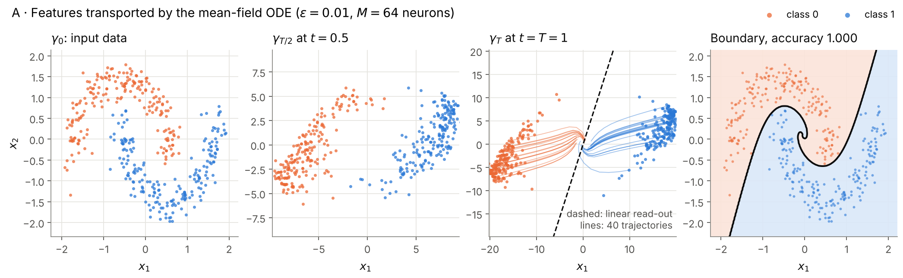

**Layout 1×4:** $\gamma_0$ (lunas entrelazadas), $\gamma_{T/2}$, $\gamma_T$ con las trayectorias completas de 40 partículas y la recta del clasificador lineal sobre $X_T$ (discontinua), y la frontera de decisión en $\mathbb{R}^2$ sobre $P(y=1|x)$ sombreada. Cada panel ajusta su ventana a los puntos de ese instante. La frontera en el espacio original es no lineal pues incorpora toda la geometría del flujo $\phi_T$, aunque el clasificador final sea lineal sobre $X_T$.

**Resultado:** accuracy 100%, $J^* = 0.0011$.

---

## 5. Experimento B — Efecto del parámetro $\varepsilon$

**Objetivo:** Estudiar cómo la intensidad de la regularización entrópica $\varepsilon$ afecta a la convergencia, la distribución de parámetros y el campo de velocidad aprendido. Optimizador: **SGLD** (SGD + cosine annealing + ruido de Langevin), coherente con el rol de $\varepsilon$ como temperatura.

**Configuración:** $\varepsilon \in \{0, 0.001, 0.01, 0.1, 0.5\}$, misma inicialización (misma semilla antes de cada modelo), 700 épocas.

### B1 — Curvas de convergencia

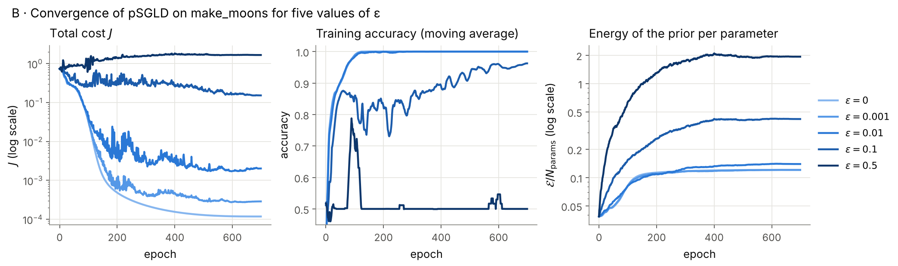

$J$ y $\mathcal{E}$ van en escala logarítmica, sin recortes; hay una curva por $\varepsilon$, en azules de claro ($\varepsilon$ pequeño) a oscuro. La accuracy se muestra como media móvil de ventana 15.

**Resultados:**

| $\varepsilon$ | $J^*$ | accuracy final |
|---|---|---|
| 0 | 0.00012 | 1.000 |
| 0.001 | 0.00027 | 1.000 |
| 0.01 | 0.0017 | 1.000 |
| 0.1 | 0.151 | 0.963 |
| 0.5 | 0.609 | 0.500 |

**Panel izquierdo (pérdida total $J$):** Con $\varepsilon \leq 0.01$ el coste baja de forma sostenida hasta $J^* \sim 10^{-4}$–$10^{-3}$; cuanto mayor es $\varepsilon$, más alto el valor final (más penalización y más ruido). Con $\varepsilon = 0.1$ el coste se estanca en torno a 0.15, y con $\varepsilon = 0.5$ **sube** desde el valor inicial hasta ≈ 1.7: el ruido de Langevin, de amplitud $\propto\sqrt{\varepsilon}$, domina al gradiente.

**Panel central (accuracy):** Los modelos con $\varepsilon \leq 0.01$ llegan al 100% hacia la época 100. Con $\varepsilon = 0.1$ la accuracy oscila y acaba en 96%. Con $\varepsilon = 0.5$ el modelo no aprende: tras un pico transitorio del 79% cae al 50% (azar) y ahí se queda.

**Panel derecho (energía del prior $\mathcal{E}/N_\text{params}$):** La energía **crece** con $\varepsilon$: ≈ 0.12 para $\varepsilon \leq 0.01$, 0.42 para $\varepsilon = 0.1$ y 1.93 para $\varepsilon = 0.5$. Con pSGLD $\varepsilon$ es también la temperatura, y el ruido dispersa los parámetros en lugar de concentrarlos en el origen.

### B2 — Fronteras de decisión + campo de velocidad

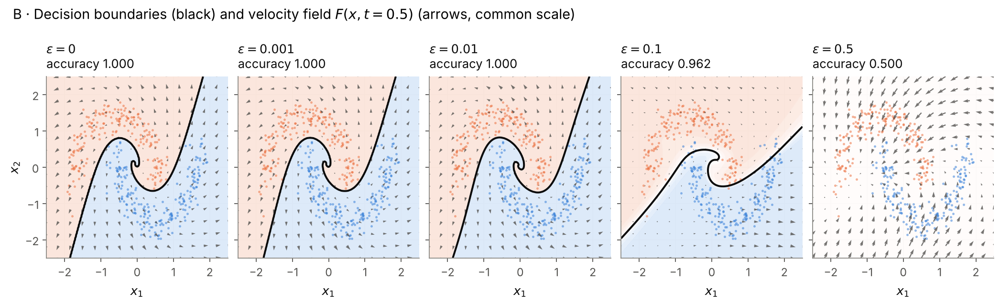

Layout **1×5** (una columna por $\varepsilon$, ventana $[-2.5, 2.5]^2$): frontera de decisión $P(y=1|x) = 0.5$ en negro sobre la probabilidad sombreada, los datos y el campo de velocidad $F(x, t=0.5)$ a mitad del flujo en flechas grises, con la misma escala en todos los paneles para que su longitud sea comparable entre $\varepsilon$.

Para $\varepsilon \leq 0.01$ las tres fronteras son prácticamente idénticas: siguen la forma de las lunas con un remolino en el centro. Con $\varepsilon = 0.1$ la frontera es más simple, la zona de transición entre clases más ancha y algunos puntos quedan mal clasificados (96%). Con $\varepsilon = 0.5$ no hay frontera: $P(y=1|x) \approx 0.5$ en toda la ventana y el campo de velocidad, el más largo de todos, ya no separa las clases. Para $\varepsilon$ pequeño el campo muestra cómo la ODE empuja las dos clases en direcciones opuestas para crear la separación que el clasificador lineal después explota.

---

## 6. Experimento C — Verificación empírica de la condición PL

**Objetivo:** Comprobar que $\|\nabla J(\theta)\|^2 \geq 2\mu \cdot (J(\theta) - J^*)$ se cumple empíricamente durante todo el entrenamiento, verificando el Meta-Teorema 2.

**Configuración:** Experimento **autocontenido** — entrena sus propios modelos con **SGD + lr constante** (`use_sgd=True`, $\varepsilon \in \{0, 0.001, 0.01, 0.1, 0.5\}$, 700 épocas). No reutiliza modelos de B. El lr constante garantiza que $J^*$ sea el mínimo geométrico real del gradient flow, sin artefactos del cosine annealing que aplanarían $J(\theta^s) - J^*$ artificialmente.

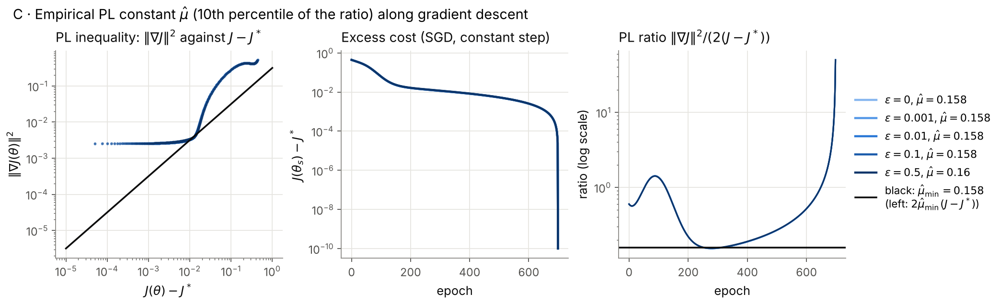

**Paneles:**
- **C1 — log-log, $\|\nabla J\|^2$ frente a $J - J^*$:** un punto por época, coloreado por $\varepsilon$, con la recta $2\hat{\mu}_\text{min}(J-J^*)$. Si PL se cumple, los puntos quedan por encima con pendiente ≈ 1.
- **C2 — semilog, $J(\theta^s) - J^*$ por época:** con PL el decaimiento es exponencial, $J(\theta_s) - J^* \lesssim (J(\theta_0) - J^*)\, e^{-2\mu s}$.
- **C3 — ratio $\|\nabla J\|^2 / (2(J - J^*))$ por época**, con la recta $\hat{\mu}_\text{min}$.

$\hat{\mu}$ (en la leyenda) es el percentil 10 del ratio. El paper garantiza $\mu > 0$ para todo $\varepsilon > 0$ pero **no** que $\mu$ crezca con $\varepsilon$.

### Resultado de la ejecución actual: no concluyente

| $\varepsilon$ | $\hat{\mu}$ | $J^*$ | accuracy final |
|---|---|---|---|
| 0 | 0.158 | 0.2824 | 0.85 |
| 0.001 | 0.158 | 0.2825 | 0.85 |
| 0.01 | 0.158 | 0.2828 | 0.85 |
| 0.1 | 0.158 | 0.2863 | 0.85 |
| 0.5 | 0.160 | 0.3014 | 0.85 |

Con 700 épocas de SGD a lr = 0.01 el entrenamiento **no ha convergido**:
- el coste sigue bajando en la última época (el mínimo de la trayectoria es justo la última), $\|\nabla J\|^2$ sigue en $2.5\cdot10^{-3}$ y la accuracy se queda en 85%, frente al 100% que alcanzan los mismos modelos con Adam (A, B);
- como $J^*$ se toma como el mínimo de la trayectoria, $J - J^* \to 0$ al final de forma artificial: es la caída vertical de C2 y la subida del ratio en C3, y en C1 los puntos de la izquierda forman una recta horizontal (gradiente constante con $J - J^*$ cada vez menor) en lugar de una pendiente 1;
- las cinco curvas son casi idénticas: $\varepsilon\cdot\mathcal{E}$ es pequeño frente al BCE en esta fase, así que $\varepsilon$ no cambia nada;
- $\hat{\mu} = 0.158$ es el valor del ratio hacia la época 280, en mitad del descenso, y no mide la constante PL cerca del minimizador.

**Pendiente:** rehacer C con un descenso que converja (más épocas o un paso mayor, posible porque el descenso es a lote completo y determinista), con $J^*$ tomado de una ejecución de referencia más larga y no de la propia trayectoria, y calculando $\hat{\mu}$ solo en las épocas con $J - J^*$ claramente por encima de la incertidumbre de $J^*$.

---

## 7. Experimento D — Genericidad: robustez a semillas

**Objetivo:** Verificar empíricamente el Meta-Teorema 1: distintas inicializaciones de parámetros y distintos datasets deben converger al mismo tipo de solución. Optimizador: Adam + cosine annealing.

**Configuración:** $n = 10$ seeds, 500 épocas, $\varepsilon \in \{0, 0.01\}$.

- **D1:** Dataset fijo (`data_seed=42`), inicialización aleatoria (seeds 0–9). Mide robustez al *paisaje de pérdida* desde distintos puntos de partida.
- **D2:** Inicialización fija (`init_seed=2`), dataset aleatorio (seeds 0–9). Mide robustez a la *distribución de datos* $\gamma_0$ — directamente el enunciado de genericidad.
- **D3:** `data_seed = init_seed = s` para cada $s$. Escenario más realista: ninguna fuente de aleatoriedad está controlada.

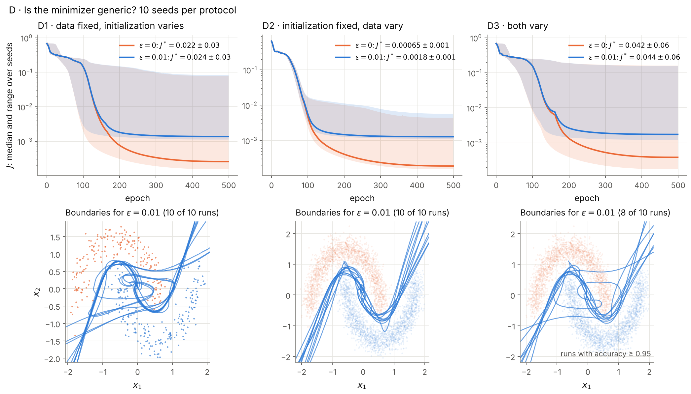

**Layout 2×3** (una columna por sub-experimento):
- **Fila superior:** $J$ por época, mediana y rango entre seeds, $\varepsilon=0$ (naranja) frente a $\varepsilon=0.01$ (azul); la leyenda da $J^*$ medio ± desviación típica.
- **Fila inferior:** fronteras de decisión superpuestas ($\varepsilon=0.01$) de los runs con acc ≥ 95%, sobre la nube de puntos de todos los datasets. D1 también muestra ahora sus fronteras.

Los $\hat{\mu}_{PL}$ de cada seed se imprimen en consola y se guardan en `figures/data/D.npz`.

### Interpretación

| Sub-experimento | $\gamma_0$ | $\theta_0$ | Fuente de variabilidad |
|---|---|---|---|
| D1 | Fija (seed=42) | Aleatoria (0–9) | Paisaje de pérdida (init) |
| D2 | Aleatoria (0–9) | Fija (seed=2) | Distribución de datos |
| D3 | Aleatoria ($s$) | Aleatoria ($s$) | Ambas combinadas |

La banda de D3 debe ser la más ancha (combina ambas fuentes). Con $\varepsilon=0.01$ la condición PL garantiza $\hat{\mu} > 0$ cerca del óptimo; la regularización no reduce necesariamente la varianza entre seeds, sino que asegura la existencia de un mínimo global estable. Las fronteras de D2/D3 son cualitativamente similares entre sí a pesar de provenir de $(\gamma_0, \theta_0)$ completamente distintos — verificación visual del Meta-Teorema 1.

### Resultados

| | $\varepsilon$ | $J^*$ (media ± std) | $\hat{\mu}$ (media ± std) |
|---|---|---|---|
| D1 | 0 | 0.022 ± 0.034 | 0.026 ± 0.022 |
| D1 | 0.01 | 0.024 ± 0.035 | 0.029 ± 0.026 |
| D2 | 0 | 0.0007 ± 0.0013 | 0.028 ± 0.011 |
| D2 | 0.01 | 0.0018 ± 0.0013 | 0.032 ± 0.013 |
| D3 | 0 | 0.042 ± 0.064 | 0.024 ± 0.028 |
| D3 | 0.01 | 0.044 ± 0.065 | 0.027 ± 0.031 |

La dispersión de D1 y D3 viene de tres inicializaciones concretas (semillas 0, 4 y 5), que se quedan en $J^* \approx 0.07$–$0.16$ con accuracy 91–97%, tanto con $\varepsilon = 0$ como con $\varepsilon = 0.01$; las otras siete llegan a accuracy 100% y $J^* \approx 10^{-3}$. Variando solo los datos (D2) los diez runs llegan a accuracy ≥ 99.8%. Con $\varepsilon = 0.01$ no desaparecen esos tres mínimos peores: la genericidad del paper habla de casi toda $\gamma_0$, no de que el descenso desde cualquier inicialización llegue al mínimo global.

---

## 8. Experimento E — Robustez de $\nu^*$ (make\_moons)

**Objetivo:** Verificar que la distribución óptima de parámetros $\nu^*$ es robusta a distintas condiciones de entrenamiento. Optimizador: **SGLD** (para explorar la distribución de Gibbs $\nu^*$, no solo el MAP).

**Configuración:** $\varepsilon = 0.01$, $n = 10$ seeds, 500 épocas cada run.

- **E-1:** `data_seed=42` fijo, `init_seed ∈ {0,...,9}` — 10 inicializaciones distintas del mismo dataset.
- **E-2:** `init_seed=2` fijo, `data_seed ∈ {0,...,9}` — 10 datasets distintos con la misma inicialización.

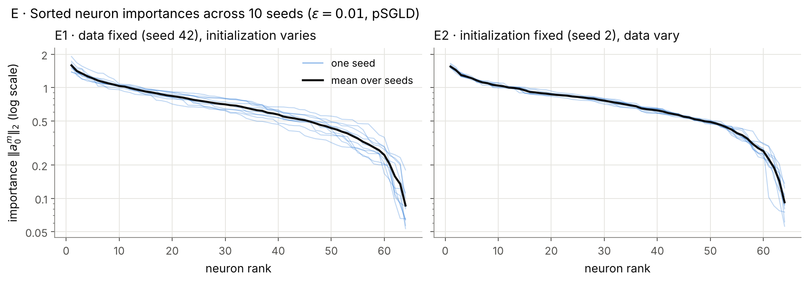

**Layout 1×2** (dos paneles en columnas):

- **Panel izquierdo (E-1):** Importancias $\|a_0^m\|_2$ ordenadas descendentemente (escala log), una curva fina azul por seed y la media en negro. Curvas finas apretadas en torno a la media indican que la estructura de importancia neuronal es robusta a la inicialización.

- **Panel derecho (E-2):** Ídem pero variando el dataset. Curvas apretadas indican robustez a $\gamma_0$ — directa verificación de que $\nu^*$ es genuinamente una propiedad de la geometría del problema, no de las condiciones de inicio.

Si el Meta-Teorema 1 se cumple (minimizador único estable), las curvas de importancia deben ser cualitativamente similares entre seeds: mismo "codo" pronunciado en los primeros ranks (pocas neuronas dominantes) y misma caída. La comparación E-1 vs E-2 permite separar cuánta variabilidad proviene de la inicialización y cuánta del dataset.

**Resultados:** en E-1, ocho de las diez inicializaciones llegan a accuracy 100% con $J^* \approx 0.002$; las semillas 4 y 5 se quedan en $J^* \approx 0.15$ con accuracy 95.5%. En E-2 los diez datasets llegan a accuracy ≥ 99.8% ($J^*$ entre 0.002 y 0.016).

---

## 9. Experimento F — Convergencia en make\_circles

**Dataset:** `make_circles(n=400, noise=0.08, factor=0.5)` — dos círculos concéntricos con simetría rotacional $SO(2)$. Optimizador: **pSGLD** en ambos sub-experimentos.

**Objetivo:** Verificar que la convergencia en make_circles es robusta tanto a la semilla de datos como a la inicialización de parámetros.

**Configuración:** $\varepsilon = 0.01$, $n = 10$ seeds, 700 épocas cada run.

- **F1:** `init_seed=4` fija, `data_seed ∈ {0,...,9}` — 10 instancias distintas de make_circles.
- **F2:** `data_seed=42` fijo, `init_seed ∈ {0,...,9}` — 10 inicializaciones distintas sobre el mismo make_circles.

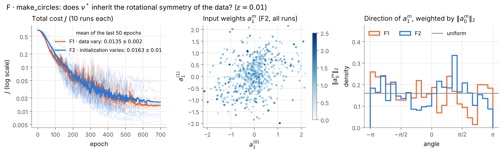

**Layout 1×3:**
- **Pérdida:** curvas de F1 (naranja) y F2 (azul), una fina por seed y la media en grueso. La leyenda da $\bar{J}_\text{final}$ (media de las últimas 50 épocas) ± std; se usa en lugar de $J^*$ porque pSGLD explora la distribución estacionaria $\nu^* \propto \exp(-J/\varepsilon)$ y no converge puntualmente al mínimo.
- **Pesos de entrada $a_1^m$** de todos los runs de F2, coloreados por la importancia $\|a_0^m\|_2$.
- **Dirección de $a_1^m$:** histograma del ángulo ponderado por $\|a_0^m\|_2$ en F1 y F2, frente a la densidad uniforme. Si $\nu^*$ hereda la simetría $SO(2)$ de los datos, el histograma debe salir plano.

**Interpretación:** Curvas apretadas en F1 y F2 indican que la convergencia es robusta tanto a variaciones del dataset como de la inicialización. La comparación F1 vs F2 permite identificar cuál fuente de aleatoriedad introduce más variabilidad.

**Resultados:** accuracy media 0.9993 ± 0.0011 en F1 (datos) y 0.9983 ± 0.0025 en F2 (inicialización); $J^*$ entre 0.010 y 0.018 en F1 y entre 0.006 y 0.023 en F2. Las dos fuentes de variabilidad dan resultados igual de estables, algo más dispersos al cambiar la inicialización.

---

## 10. Experimento G — Problema de convergencia ($N \to \infty$)

**Objetivo:** Verificar empíricamente que el valor óptimo del problema de campo medio finito $J^*_N$ converge al valor óptimo con infinitas partículas $J^*_\infty$ cuando $N \to \infty$, y estimar la tasa de convergencia. Optimizador: **pSGLD** (coherente con el rol de $\varepsilon$ como temperatura).

**Marco teórico:** El paper trabaja con distribución inicial continua $\gamma_0$ y el límite $M \to \infty$ neuronas. El caso con $N$ datos finitos queda fuera de su alcance: en la Sección 1.6 (punto 3) los autores lo señalan como extensión futura. La convergencia $J^*_N \to J^*_\infty$ es por tanto una **conjetura**, no un resultado demostrado. La tasa natural esperada por analogía con la ley de los grandes números sería $\text{gap}(N) \sim C \cdot N^{-0.5}$. El experimento busca evidencia empírica y estima la tasa $\alpha$.

**Configuración:** $N \in \{50, 100, 200, 400, 800, 1600, 3200\}$ (progresión geométrica de razón 2, desde datos escasos hasta régimen rico; $N=400$ es el valor estándar del resto de experimentos), $\varepsilon \in \{0, 0.01\}$, 20 seeds por combinación, 700 épocas.

**Estimador de $J^*_\infty$:** Se evalúa la BCE (sin regularización) sobre un test set oráculo de $N_\text{test} = 10\,000$ puntos (semilla fija = 999), que aproxima la medida continua $\gamma_0$. El gap de generalización es
$$\text{gap}(N) = \text{BCE}_\text{test}(N) - \text{BCE}_\text{train}(N).$$

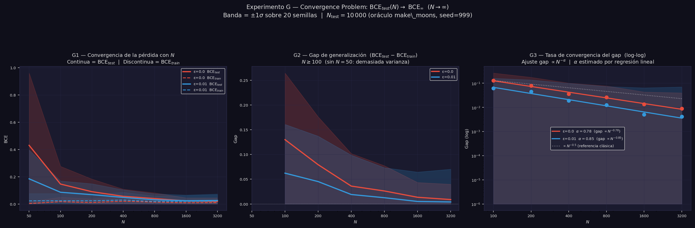

**Layout 1×2:**

- **G1 — Convergencia de la pérdida con $N$:** BCE$_\text{test}$ (línea continua) y BCE$_\text{train}$ (línea discontinua), media ±1σ sobre 20 seeds, vs. $N$ en escala log en $x$. La brecha entre ambas es el sobreajuste: grande para $N$ pequeño, pequeña para $N$ grande. Con $\varepsilon=0.01$ la curva de test queda por debajo de la de $\varepsilon=0$ para $N$ pequeño — la regularización actúa como prior que compensa la falta de datos.

- **G2 — Gap de generalización y su tasa (log-log):** BCE$_\text{test}$ $-$ BCE$_\text{train}$ vs. $N$, que cuantifica el sobreajuste y decrece al crecer $N$ porque la distribución empírica aproxima mejor a $\gamma_0$. Se ajusta una recta a $\log\,\text{gap}(N)$ vs. $\log N$ sobre $N \geq 100$ (se excluyen $N < 100$ porque en el régimen escaso el gap no sigue aún la ley de potencias). La pendiente es $-\alpha$. Resultados empíricos:
  - $\varepsilon=0$: $\alpha \approx 0.78$
  - $\varepsilon=0.01$: $\alpha \approx 0.85$

  Ambas tasas son más rápidas que la referencia $N^{-1/2}$, dibujada en gris.

---

## 11. Experimento H — Diagnóstico de pSGLD

> Las cifras de H–K son de la ejecución con el código actual, con prior $\nu^\infty \propto e^{-\ell(a)}$ (independiente de $\varepsilon$). Sustituyen a las de una versión anterior que usaba $e^{-\ell(a)/\varepsilon}$.

**Objetivo:** Cuantificar la brecha entre la distribución estacionaria empírica de pSGLD ($\hat{\nu}^*$) y el prior de Gibbs teórico $\nu^\infty$. La causa es estructural: $\mathrm{KL}(\nu_N\|\nu^\infty) = +\infty$ porque $\nu_N = \frac{1}{M}\sum_m \delta_{a^m}$ es discreta y $\nu^\infty$ es continua — el término entrópico del funcional $J$ no está bien definido en el régimen discreto.

**Protocolo:**
1. Entrenar con pSGLD (800 épocas) y recoger 2000 snapshots post-convergencia (thin=10) → $\hat{\nu}^*$ como promedio ergódico.
2. Generar 8000 muestras de $\nu^\infty \propto e^{-\ell(a)}$ por ULA con paso $\eta = 0.01$ (el prior no depende de $\varepsilon$).
3. Calcular MMD² y $W_1$ entre los tres objetos: $\nu_N$ (64 partículas finales), $\hat{\nu}^*$ (trayectoria), $\nu^\infty$ (ULA).

**Métricas:**
$$\mathrm{MMD}^2(P,Q) = \mathbb{E}_{x,x'\sim P}[k(x,x')] - 2\mathbb{E}_{x\sim P,y\sim Q}[k(x,y)] + \mathbb{E}_{y,y'\sim Q}[k(y,y')]$$
con kernel gaussiano $k(x,y) = \exp(-\|x-y\|^2/2\sigma^2)$, $\sigma$ por heurística de mediana.

**Resultados:**

| Par | MMD² | $W_1$ por coordenada |
|---|---|---|
| $\nu_N$ vs $\hat{\nu}^*$ | −0.003 (≈ 0) | 0.05–0.09 |
| $\hat{\nu}^*$ vs $\nu^\infty$ | **0.071** | 0.23–0.48 |
| $\nu_N$ vs $\nu^\infty$ | 0.027 | 0.19–0.42 |

**Conclusión:** las 64 partículas finales son una muestra típica de la estacionaria de pSGLD: su distancia a $\hat{\nu}^*$ está al nivel del ruido del estimador (el MMD² insesgado sale incluso negativo). $\hat{\nu}^*$ sí se separa del prior: es más estrecha que $\nu^\infty$ en $a_0^{(1)}$, $a_1^{(1)}$ y $a_2$, con un pico en 0, y bimodal en $a_0^{(0)}$ y $a_1^{(0)}$, mientras que el prior es unimodal. Esa separación es la esperada, porque con $\varepsilon = 0.01$ el término de datos aleja $\nu^*$ del prior. Por eso H no basta para decir si pSGLD muestrea bien $\nu^*$: para eso haría falta una referencia de $\nu^*$ independiente. Con solo 64 partículas el MMD² frente al prior también es ruidoso, lo que explica que $\nu_N$ salga más cerca del prior (0.027) que $\hat{\nu}^*$ (0.071).

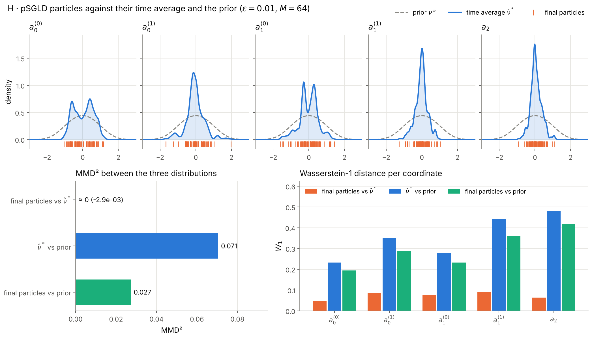

---

## 12. Experimento I — MMD y Sinkhorn como regularizadores (make\_moons)

**Motivación:** Dado que $\mathrm{KL}(\nu_N\|\nu^\infty)=+\infty$, se proponen MMD² y la divergencia de Sinkhorn como alternativas bien definidas que no requieren absolutamente continuidad entre medidas.

**Objetivo de entrenamiento:**
$$J_\text{MMD} = \mathcal{L} + \varepsilon\cdot\widehat{\mathrm{MMD}}^2(\nu_N, \nu^\infty), \qquad J_\text{Sink} = \mathcal{L} + \varepsilon\cdot S_\sigma(\nu_N, \nu^\infty)$$

La divergencia de Sinkhorn debiased es:
$$S_\sigma(P,Q) = \mathrm{OT}_\sigma(P,Q) - \tfrac{1}{2}\mathrm{OT}_\sigma(P,P) - \tfrac{1}{2}\mathrm{OT}_\sigma(Q,Q)$$
implementada en dominio logarítmico para estabilidad numérica.

**Configuración:** make\_moons, $N=400$, $\varepsilon=0.01$, 700 épocas.

**Figura (2×2):** BCE de entrenamiento; marginal de $a_0^{(0)}$ (prior, $\hat{\nu}^*_\text{pSGLD}$ y las partículas entrenadas con MMD y Sinkhorn); $W_1$ por coordenada entre las partículas **entrenadas** de cada método y $\hat{\nu}^*_\text{pSGLD}$, con las partículas finales del propio pSGLD como suelo de muestreo ($M = 64$); y $W_1$ tras continuar cada solución 1000 pasos con pSGLD (la comparación original). Esa continuación acerca cualquier punto de partida a la estacionaria de pSGLD, así que el tercer panel es el que compara los regularizadores tal cual.

**Resultados:** Los tres métodos llegan a accuracy 100%. MMD y Sinkhorn bajan el BCE de forma suave hasta ≈ $1$–$2\cdot10^{-4}$; pSGLD es más ruidoso y acaba en ≈ $6\cdot10^{-4}$. Las distribuciones de parámetros son parecidas:

| | MMD² frente a $\hat{\nu}^*_\text{pSGLD}$ | $W_1$ por coordenada |
|---|---|---|
| partículas finales de pSGLD (suelo de muestreo) | −0.007 | 0.02–0.04 |
| partículas entrenadas con MMD | −0.0003 | 0.06–0.11 |
| partículas entrenadas con Sinkhorn | 0.002 | 0.05–0.24 |
| MMD + 1000 pasos de pSGLD | 0.005 | 0.06–0.10 |
| Sinkhorn + 1000 pasos de pSGLD | 0.007 | 0.05–0.20 |

Todos los MMD² están al nivel del ruido de muestreo con $M = 64$. La diferencia más visible es Sinkhorn en $a_2$ ($W_1 = 0.24$). En clasificación la tarea no discrimina entre regularizadores.

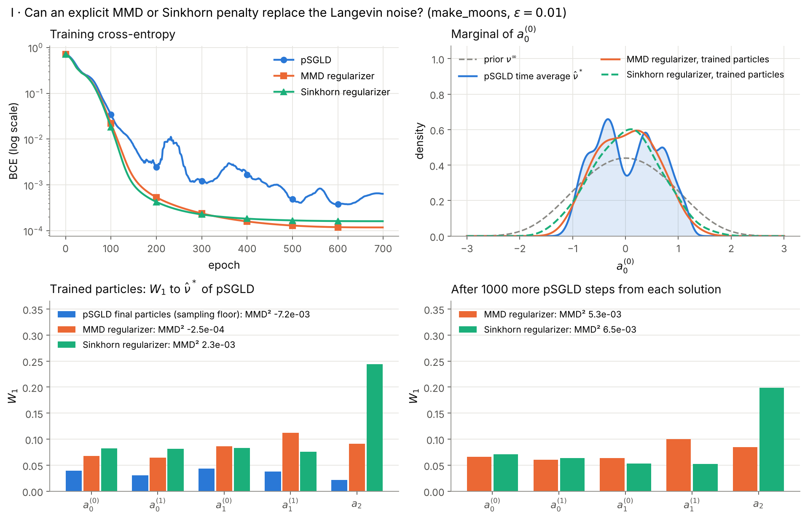

---

## 13. Experimento J — Regresión: California Housing PCA(2)

**Motivación:** En clasificación el BCE final es tan pequeño que el regularizador pesa más que él: con pSGLD en el Experimento I, $\varepsilon\cdot\mathrm{reg}/\text{BCE} \approx 2$ al final. En regresión con $\varepsilon=0.01$ el MSE no baja de ≈ 0.6 y el regularizador pesa poco: $\varepsilon\cdot\mathrm{reg}/\text{MSE} \approx 0.2\%$ con pSGLD, menos del 0.1% con MMD y 3.6% con Sinkhorn (Experimento K). La comparación en regresión es más informativa.

**Dataset:** California Housing (8 variables: MedInc, HouseAge, AveRooms, AveBedrms, Population, AveOccup, Latitude, Longitude). Se proyecta a $\mathbb{R}^2$ por PCA:
- **PC1** (25.7%): eje geográfico dominado por Latitud (+0.62) y Longitud (−0.60)
- **PC2** (23.2%): eje socioeconómico dominado por AveRooms (+0.62), AveBedrms (+0.45), MedInc (+0.40)

El techo de $R^2 \approx 0.25$ refleja que el 51.1% de varianza descartada por PCA(2) contiene información predictiva del precio.

**Resultados** ($\varepsilon=0.01$, 700 épocas):

| Método | MSE$_\text{train}$ | MSE$_\text{test}$ | $R^2_\text{train}$ | $R^2_\text{test}$ |
|---|---|---|---|---|
| pSGLD | 0.717 | 0.816 | 0.282 | 0.187 |
| MMD-reg | 0.612 | 0.804 | 0.387 | 0.199 |
| Sinkhorn-reg | 0.596 | 0.815 | 0.403 | 0.188 |

En test los tres métodos empatan ($R^2$ entre 0.19 y 0.20). MMD y Sinkhorn ajustan mejor el entrenamiento ($R^2$ 0.39–0.40 frente a 0.28) pero no generalizan mejor: su brecha entre train y test es el doble que la de pSGLD. Los tres subestiman los precios más altos (la columna de puntos de la derecha del tercer panel es el valor máximo censurado del dataset). El efecto de la escala de $\varepsilon$ se estudia en el Experimento K.

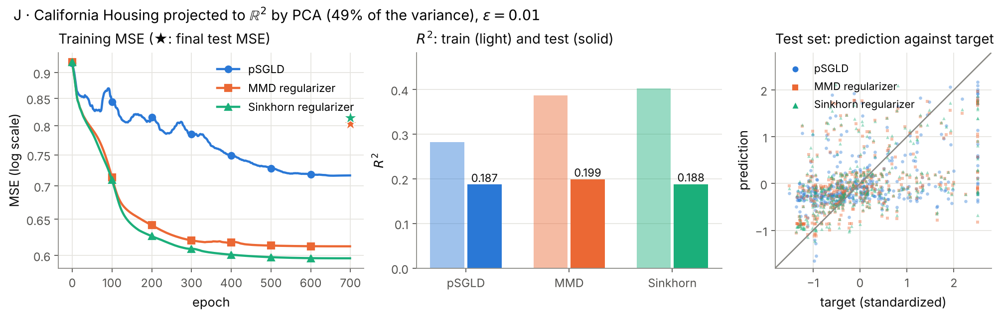

---

## 14. Experimento K — Barrido de $\varepsilon$ en regresión

**Motivación:** Con $\varepsilon=0.01$ la fracción de regularización en regresión es ≈ 0.002 con pSGLD, frente a ≈ 2 en clasificación. Se barre $\varepsilon \in \{0.001, 0.01, 0.1, 0.5, 1.0, 5.0\}$ con las mismas muestras del prior para todos los $\varepsilon$ ($\nu^\infty \propto e^{-\ell(a)}$ no depende de $\varepsilon$).

**Resultados ($R^2_\text{test}$):**

| $\varepsilon$ | pSGLD | MMD | Sinkhorn |
|---|---|---|---|
| 0.001 | **0.236** | **0.212** | 0.208 |
| 0.01 | 0.158 | 0.211 | 0.198 |
| 0.1 | −0.000 | 0.201 | 0.214 |
| 0.5 | −0.003 | 0.202 | 0.228 |
| 1.0 | −0.265 | 0.160 | **0.229** |
| 5.0 | −51.6 | 0.181 | 0.181 |

Fracción de regularización $\varepsilon\cdot\mathrm{reg}/\text{MSE}$: pSGLD 0.000 → 9.8, MMD siempre < 0.01, Sinkhorn 0.004 → 11.2 (de $\varepsilon = 0.001$ a $\varepsilon = 5$).

**Conclusiones:**
- **pSGLD**: funciona solo con $\varepsilon\leq 0.01$: su ruido de Langevin $\propto\sqrt{\varepsilon}$ destruye el aprendizaje a partir de $\varepsilon = 0.1$ ($R^2 \approx 0$) y con $\varepsilon = 5$ diverge (MSE = 52.8). Su mejor $R^2$ se alcanza cuando la regularización casi desaparece ($\varepsilon = 0.001$).
- **MMD**: casi plano, $R^2$ entre 0.20 y 0.21 para $\varepsilon \leq 0.5$ y algo peor después (0.16–0.18). La fracción de regularización es siempre pequeña porque MMD² está acotado por construcción.
- **Sinkhorn**: mejora ligeramente con $\varepsilon$ hasta $\varepsilon = 1$ ($R^2 = 0.229$) y baja a 0.181 con $\varepsilon = 5$, sin colapsar aunque el regularizador pese once veces el MSE.
- **Al $\varepsilon$ óptimo de cada método**: pSGLD (0.236, $\varepsilon = 0.001$) > Sinkhorn (0.229, $\varepsilon = 1$) > MMD (0.212, $\varepsilon = 0.001$). Las diferencias son de 0.025 como mucho en $R^2$, con una sola semilla y una sola partición train/test, así que no bastan para ordenar los métodos; harían falta varias semillas.

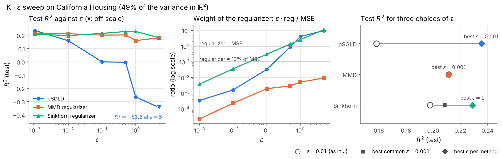

---

## 15. Conclusiones

| Resultado del paper | Verificación empírica |
|---|---|
| La ODE transforma $\gamma_0$ en $\gamma_T$ linealmente separable | Exp. A: lunas → puntos separados, acc ≈ 100% |
| $\varepsilon$ es a la vez peso del regularizador y temperatura | Exp. B: con pSGLD, $\varepsilon \leq 0.01$ llega al 100% de accuracy, $\varepsilon = 0.1$ al 96% y $\varepsilon = 0.5$ no aprende (50%); la energía de los parámetros crece con $\varepsilon$ |
| Condición PL: $\|\nabla J\|^2 \geq 2\mu(J-J^*)$ con $\mu > 0$, y convergencia exponencial | Exp. C: **pendiente**; la ejecución actual no converge en 700 épocas (accuracy 85%, $J^*$ tomado del final de la trayectoria) y no permite medir $\mu$ (§6) |
| Genericidad (Meta-Teorema 1): minimizador único para casi toda $\gamma_0$ | Exp. D2/D3: fronteras de decisión cualitativamente similares entre data seeds |
| $\varepsilon > 0$ garantiza existencia de minimizador estable cerca del óptimo | Exp. D1: $\hat{\mu} > 0$ para todo init seed con $\varepsilon=0.01$, aunque 3 de 10 inicializaciones acaban en un mínimo peor (accuracy 97%) con y sin regularización |
| $\nu^*$ es robusta a las condiciones de entrenamiento | Exp. E: curvas de importancia $\|a_0^m\|_2$ estables entre seeds |
| La convergencia es robusta a semillas de datos e inicialización | Exp. F: make\_circles — bandas de pérdida estrechas en F1 y F2 |
| *Problema abierto*: $J^*_N \to J^*_\infty$ cuando $N \to \infty$ | Exp. G: BCE$_\text{test}$ converge con tasa empírica $\alpha \approx 0.78$–$0.85$ |
| $\mathrm{KL}(\nu_N\|\nu^\infty)=+\infty$ con $M=64$ Dirac deltas | Exp. H: las partículas finales son una muestra típica de la estacionaria de pSGLD (MMD² ≈ 0), que se separa del prior (MMD² = 0.071) como corresponde a un óptimo que ajusta los datos |
| MMD² y Sinkhorn son alternativas bien definidas a la KL | Exp. I: en clasificación los tres métodos llegan al 100% con distribuciones de parámetros parecidas; Exp. J: en regresión empatan en test ($R^2$ 0.19–0.20) |
| La escala de $\varepsilon$ es crítica en regresión | Exp. K: pSGLD colapsa para $\varepsilon\geq 0.1$; MMD y Sinkhorn aguantan hasta $\varepsilon = 5$. Al $\varepsilon$ óptimo, pSGLD (0.236) ≈ Sinkhorn (0.229) ≈ MMD (0.212), diferencias de una sola semilla |

**Limitaciones de la implementación:**
1. **Restricción temporal:** $a_0^m$ y $a_1^m$ son constantes en $t$; solo $a_2^m(t)$ varía linealmente. El espacio de controles es un subconjunto estricto del del paper.
2. **Término de regularización (A–G):** Solo se implementa el término de energía de la KL ($\mathbb{E}_\nu[\ell(a)]$). El término de entropía $-H(\nu_t)$ se aproxima mediante el ruido de Langevin.
3. **Término de regularización (H–K):** MMD² y Sinkhorn son sustitutos bien definidos de la KL pero miden cosas distintas: MMD compara momentos integrados; Sinkhorn compara geometría de masas (transporte óptimo).
4. **$M$ finito:** La teoría es exacta en el límite $M \to \infty$. Los experimentos usan $M=64$ partículas.
5. **PCA(2) en regresión:** La proyección a $\mathbb{R}^2$ captura solo el 48.9% de la varianza de California Housing, imponiendo un techo de $R^2\approx 0.25$ independiente del método.

---

## Referencias

- Daudin, S. & Delarue, F. (2025). *Genericity of the Polyak-Łojasiewicz inequality for mean-field Neural ODEs with entropic regularization.* arXiv:2507.08486.
- Chen, R. T. Q., Rubanova, Y., Bettencourt, J., & Duvenaud, D. (2018). *Neural Ordinary Differential Equations.* NeurIPS.
- Welling, M. & Teh, Y. W. (2011). *Bayesian Learning via Stochastic Gradient Langevin Dynamics.* ICML.
- Li, C., Chen, C., Carlson, D., & Carin, L. (2016). *Preconditioned Stochastic Gradient Langevin Dynamics for Deep Neural Networks.* AAAI.
- Polyak, B. T. (1963). *Gradient methods for minimizing functionals.* Zh. Vychisl. Mat. Mat. Fiz., 3(4), 643–653.
- Gretton, A., Borgwardt, K. M., Rasch, M. J., Schölkopf, B., & Smola, A. (2012). *A Kernel Two-Sample Test.* JMLR, 13:723–773.
- Feydy, J., Séjourné, T., Vialard, F.-X., Amari, S., Trouvé, A., & Peyré, G. (2019). *Interpolating between Optimal Transport and MMD using Sinkhorn Divergences.* AISTATS.
- Villani, C. (2003). *Topics in Optimal Transportation.* AMS Graduate Studies in Mathematics, vol. 58.
